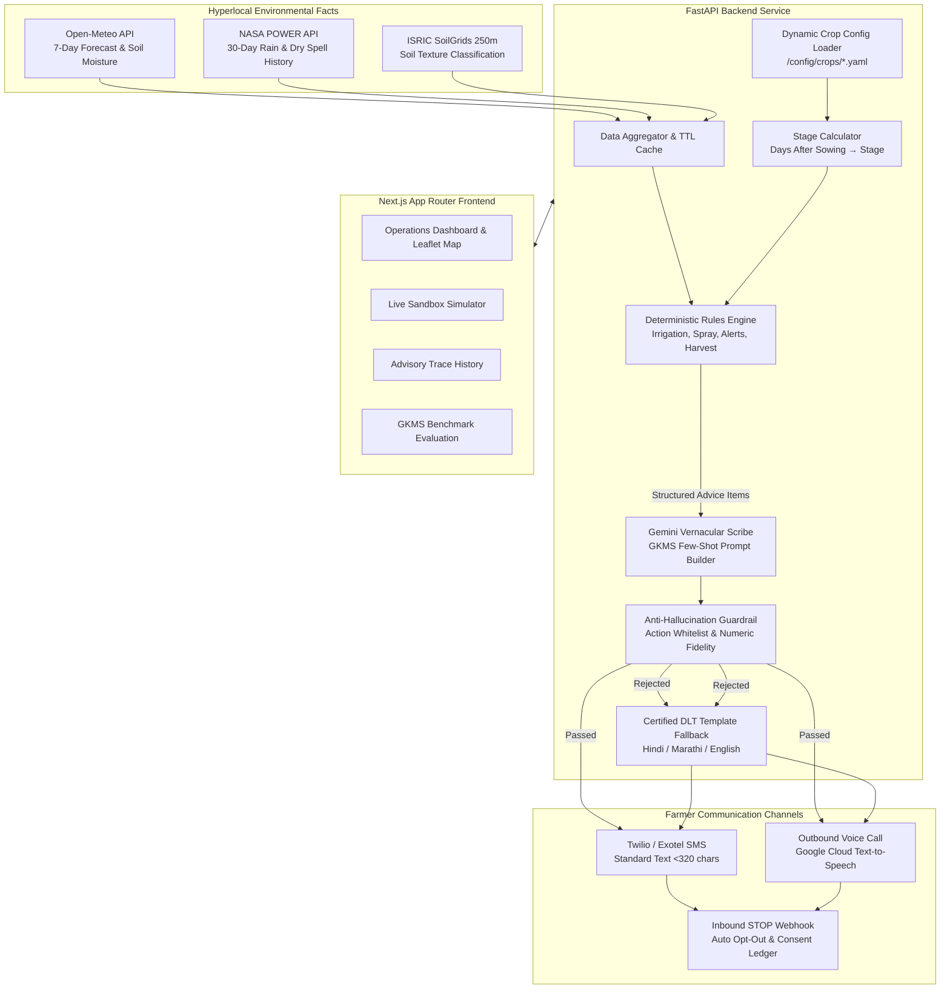

# KisanSaathi (किसान साथी)
### Hyperlocal, Actionable, Vernacular Agro-Advisory Engine for Smallholder Farmers

[](https://fastapi.tiangolo.com)
[](https://nextjs.org)
[](https://www.typescriptlang.org)
[](https://www.python.org)
[](https://tailwindcss.com)
[]()

## 🌐 Live Demo

| | Link |
|---|---|
| **Farmer app** (phone-first, Marathi / Hindi / English) | **https://frontend-xi-nine-44.vercel.app/kisan** |
| Admin dashboard | https://frontend-xi-nine-44.vercel.app |
| API health check | https://kisansaathi-api-mw3u.onrender.com/api/v1/health |
| API docs (Swagger) | https://kisansaathi-api-mw3u.onrender.com/docs |

**Try it:** open the farmer app on a phone → pick a crop (e.g. Soybean) → pick a district or tap *Use my location* → pick the crop age → *Show today's advice*, then tap 🔊 *Listen*. The 🎤 button lets you answer by speaking, and *Add to Home screen* installs it like an app.

> **Heads-up for reviewers:** the API runs on a free Render instance that sleeps when idle, so the **first request can take about 50 seconds**. Weather and soil data are live; SMS, WhatsApp and voice-call delivery are **simulated** (`DRY_RUN=true`). The database resets on every redeploy.

---

## 1. Problem Statement & Core Philosophy

Smallholder farmers across rural India face severe yield losses due to erratic climate shocks (terminal heat waves, unseasonal rainfall, prolonged dry spells, high winds causing spray drift) and lack usable, crop-stage-specific guidance in their native language. Existing smartphone apps fail to reach the most vulnerable farmers who rely on basic feature phones (2G/3G) with no internet access.

**KisanSaathi** solves this by delivering hyperlocal, actionable, crop-stage-specific agricultural guidance directly to ordinary mobile phones via standard **SMS** and automated outbound **Voice Calls (TTS)** in **Hindi**, **Marathi**, and **English**.

### Immutable Design Principles
1. **Zero LLM Agronomic Authority**: A Generative AI model must **NEVER** decide agricultural actions, chemical dosages, or irrigation timings. All agronomic decisions are derived by a strictly deterministic, explainable Rules Engine reading expert-cited crop configuration files.
2. **Generative AI as Vernacular Scribe Only**: The Large Language Model (Gemini API) is employed purely to translate and summarize structured advice objects into empathetic, simple, high-impact SMS text (<320 characters) and voice scripts.
3. **Rigid Output Guardrails & DLT Template Fallback**: Every generated message undergoes algorithmic AST/regex validation. If an unapproved action (e.g. recommending "pesticide spray" when only irrigation advice was produced) or mismatched numerical quantity is detected, the system immediately drops the LLM response and falls back to pre-certified, TRAI DLT-compliant message templates.
4. **Dynamic Configuration Driven**: No crop names, growth stages, or agro-climatic thresholds may be hardcoded. Crops are defined strictly in `/config/crops/*.yaml` and discovered dynamically by the backend, registration form, and sandbox simulator. Adding a new crop requires only adding a new YAML file.
5. **Full Explainability & Auditability**: Every advice item is linked to a reason code, parameter dictionary, data confidence score, and specific State Agricultural University (MPKV Rahuri, VNMKV Parbhani, PDKV Akola) or ICAR source citations marked with `# NEEDS_EXPERT_REVIEW`.

---

## 2. System Architecture



---

## Farmer Web App (`/kisan`) — no download needed

The admin dashboard at `/` is built for agriculture officers. Farmers use a separate, phone-first page at **`/kisan`**:

- **Three questions only**: crop (big pictures), district (or "use my location"), and a rough crop age ("1 to 2 months") — farmers rarely know an exact sowing date.
- **One clear answer**: a large action card ("आज पाणी द्या" / "Do not spray today"), one plain sentence, and a big 🔊 Listen button. Other notes appear as colour-coded icons.
- **Marathi / Hindi / English** switch at the top; Marathi is the default.
- **Remembers the farmer** in the browser (no login, no account), so a return visit opens straight to today's advice.
- **Installable without an app store**: a web app manifest lets the farmer choose *Add to Home screen* in the browser. It then opens full-screen with its own icon.

Ways to reach farmers without any app:

| Channel | Needs smartphone? | Status |
|---|---|---|
| `/kisan` web page (share link / QR code) | Yes, any browser | Working |
| Phone notification (installed PWA, 06:30 IST) | Yes | Working once `VAPID_*` keys are set |
| WhatsApp message (falls back to SMS) | Yes | Code ready; needs Twilio WhatsApp sender + `DRY_RUN=false` |
| SMS (< 320 characters) | No | Code ready; needs Twilio + TRAI DLT approval |
| Automated voice call | No | Code ready; needs Twilio + TTS |
| Missed-call → callback with voice advice | No (basic phone) | Code ready; needs a Twilio number + public URL |

On the page itself, farmers can also **speak instead of tapping** ("तूर, लातूर, ४५ दिवस") using the browser's speech recognition. It is a convenience on top of the buttons, not a replacement: support for Marathi varies by phone, and it falls back to Hindi recognition.

### Daily delivery channels

The scheduler (`backend/app/services/scheduler/task_scheduler.py`) starts with the API (set `SCHEDULER_ENABLED=false` to stop it; run a single API worker so jobs don't duplicate). At 06:30 IST it generates advice for every active farmer and delivers it:

1. **WhatsApp** if `TWILIO_WHATSAPP_FROM` is set; on failure it falls back to **SMS**.
2. **Voice call** playing the neural-voice audio, if the farmer consented.
3. **Web Push** to every installed-PWA subscriber (`POST /api/v1/push/subscribe`).

An hourly check sends only new high-urgency alerts (24-hour de-duplication).

**Missed-call IVR.** Point your Twilio number's "A call comes in" webhook at `POST {PUBLIC_BASE_URL}/api/v1/delivery/webhooks/ivr`. The call is rejected (free for the farmer), then KisanSaathi calls back the registered number and plays today's advice. Callbacks are limited to one per farmer per 10 minutes and Twilio signatures are verified when real credentials are configured. Set `NEXT_PUBLIC_MISSED_CALL_NUMBER` to show the number on `/kisan`.

**Enable it for real**

```bash
cd backend && ./venv/bin/python -m scripts.generate_vapid   # copy the two lines into .env
```

Then set in `.env`: `VAPID_*` for push; `PUBLIC_BASE_URL` (public HTTPS API URL), `TWILIO_ACCOUNT_SID`, `TWILIO_AUTH_TOKEN`, `TWILIO_FROM_PHONE`, `TWILIO_WHATSAPP_FROM` and `DRY_RUN=false` for real messages. With `DRY_RUN=true` (default) every channel is logged and simulated, and nothing is sent.

Notes: on iPhone, push works only after *Add to Home Screen* (iOS 16.4+) and over HTTPS. Phone numbers entered on `/kisan` are encrypted at rest and need the farmer's tick-box consent.

### Voice

Voice audio is generated on the backend (`backend/app/services/delivery/tts_service.py`), in this order of preference:

1. **Google Cloud TTS** — when `GOOGLE_APPLICATION_CREDENTIALS` is set and `DRY_RUN=false`.
2. **Neural voices via `edge-tts`** (default, no key needed): `mr-IN-AarohiNeural`, `hi-IN-SwaraNeural`, `en-IN-NeerjaNeural`. Needs internet; the advisory text (crop and weather advice only, no personal data) is sent to Microsoft's speech service. This uses an unofficial endpoint, so treat it as demo-grade and switch to Google Cloud TTS or Azure Speech for production.
3. **Offline tone** — a placeholder beep if there is no network.

The browser player plays this audio first and only falls back to the browser's built-in voices if it fails (macOS has no Marathi voice, so Marathi falls back to a Hindi voice).

---

## Project Status

KisanSaathi is a **working prototype**, not a production service. See [`docs/AUDIT.md`](docs/AUDIT.md) for the feature-by-feature audit and [`INPUTS_NEEDED.md`](INPUTS_NEEDED.md) for what is required to go live.

- **Working**: rules engine for 7 crops, growth-stage logic, live weather and soil data, guarded message generation with template fallback, farmer registration with encrypted phone numbers, admin dashboard with history and stats, the `/kisan` farmer page, neural voice.
- **Simulated until configured**: SMS, WhatsApp and voice calls (no Twilio credentials or `DRY_RUN=true`), AI wording (no Gemini key — fixed templates are used). The new channels (WhatsApp, missed-call callback, web push) are unit-tested but have not been exercised against live Twilio or a real push service yet.
- **Not built yet**: weekly outlook message, inbound "START" registration, admin login, a public "Data & Methods" page.
- **Needs expert review**: every crop threshold is marked `# NEEDS_EXPERT_REVIEW`; an agronomist must validate them before real farmers rely on the advice. The GKMS benchmark file currently holds only 6 synthetic cases.

---

## 3. Environmental Data Sources & Attribution

> [!NOTE]
> **Scientific Accuracy Notice**: The environmental APIs utilized below are **model-reanalysis and satellite-assimilated gridded products**, not raw satellite imagery. They provide continuous, calibrated estimates at farmer coordinates.

| Data Source | What It Provides | Spatial & Temporal Resolution | License & Terms | Attribution Requirements |
|---|---|---|---|---|
| **Open-Meteo API** | 7-day weather forecast (temp, rain, wind, RH), multi-depth soil moisture (0-7cm, 7-28cm), and soil temperature | Hourly & Daily; ~1 km to 11 km grid | Non-commercial & Open Data (CC-BY-4.0) | "Weather data by Open-Meteo.com" |
| **NASA POWER API** | Last 30 days daily precipitation and temperature history for exact lat/lon; used for consecutive dry spell & cumulative rain checks | Daily point queries; 0.5° x 0.5° assimilation | Public Domain (NASA Open Data Policy) | "Data courtesy of NASA Langley Research Center POWER Project" |
| **ISRIC SoilGrids 2.0** | Clay, sand, and silt percentages at depths; derived USDA soil texture class (e.g., Clay Loam / Black Cotton Soil) | 250 m global spatial grid; static | Creative Commons Attribution 4.0 (CC-BY-4.0) | "Soil data derived from ISRIC SoilGrids 250m" |
| **IMD GKMS Bulletins** | Historical expert district agromet advisories used as ground-truth evaluation benchmark and few-shot examples | District-level; Bi-weekly (Tuesdays & Fridays) | Government Open Data License - India (GODL-India) | "Data courtesy of India Meteorological Department (IMD), Ministry of Earth Sciences" |
| **Kisan Call Centre (KCC)** | Anonymized query logs from farmers across Maharashtra on data.gov.in; informs real farmer question intents | Point call records | Government Open Data License - India (GODL-India) | "Department of Agriculture & Farmers Welfare, Ministry of Agriculture and Farmers Welfare" |
| **AI4Bharat & Bhashini** | Agricultural vernacular terms and translations in Hindi and Marathi | Linguistic glossaries | Creative Commons Attribution 4.0 (CC-BY-4.0) | "AI4Bharat, IIT Madras & Digital India Bhashini" |

---

## 4. Crop Configuration Knowledge Base (`/config/crops/`)

Every crop configuration is a self-contained YAML document. **No crop names, growth stages, or agro-climatic thresholds may be hardcoded anywhere in application code.**

### Shipped Crop Configurations
Seven crops ship in `/config/crops/`: wheat, rice, cotton, soybean, maize, sugarcane and tomato. The two most detailed are described below; the rest follow the same schema (`config/crops/schema.json`) and are all flagged for expert review.

1. **Rabi Wheat (`wheat_maharashtra.yaml`)**:
   - Encodes MPKV Rahuri *Package of Practices for Rabi Crops* (pp. 38–46) and ICAR-IIWBR guidelines.
   - Growth stages: Crown Root Initiation (CRI), Tillering, Late Jointing & Flowering, Milking & Dough, Maturity.
   - Stage-by-stage soil moisture depletion triggers (35% at CRI, 40% at tillering), heat stress limits (34°C at flowering, 35°C terminal), and wind drift limits (12 km/h).
2. **Kharif Soybean (`soybean_maharashtra.yaml`)**:
   - Encodes VNMKV Parbhani *Package of Practices for Kharif Crops* and ICAR-IISR Indore Technical Bulletin No. 58.
   - Growth stages: Germination & Seedling, Vegetative Branching, Flowering, Pod Development & Seed Fill, Maturity.
   - Stage-by-stage waterlogging thresholds, pod fill moisture triggers (45%), and pre-harvest interval (PHI) chemical restrictions.

### Agronomy Citation & Expert Review Protocol
- Every threshold in a crop config has a `source` field citing the specific document and page.
- Every unverified threshold includes a `# NEEDS_EXPERT_REVIEW` comment.
- If a citation is not definitively validated, it is designated as `"SOURCE_TBD"`. Never invent or fabricate agronomic citations.

---

## 5. Telecom Compliance & TRAI DLT Regulations (India)

Commercial and transactional SMS messaging in India is governed by TRAI's **Telecom Commercial Communications Customer Preference Regulations (TCCCPR, 2018)** using Distributed Ledger Technology (DLT).

### DLT Registration Requirements
1. **Principal Entity (PE) Registration**: KisanSaathi must be registered as a PE on telecom operator DLT portals (e.g. Jio, Airtel, Vodafone Idea, BSNL).
2. **Sender ID (Header)**: Requires an approved 6-character alphabetic sender ID (e.g. `KSATHI` or `KISANX`).
3. **Template Registration**: Every SMS format must be registered with fixed text and variable parameters `{#var#}`.
4. **Certified DLT Templates (`/data/language/dlt_templates.json`)**:
   KisanSaathi ships with certified DLT templates in Hindi, Marathi, and English for:
   - `IRRIGATE` (`DLT-KS-IRR-01`)
   - `SKIP_IRRIGATION` (`DLT-KS-SKP-01`)
   - `SAFE_SPRAY` (`DLT-KS-SPR-01`)
   - `AVOID_SPRAY` (`DLT-KS-SPR-02`)
   - `HEAT_ALERT` (`DLT-KS-ALT-01`)
   - `RAIN_ALERT` (`DLT-KS-ALT-02`)
   - `DROUGHT_ALERT` (`DLT-KS-ALT-03`)
   - `HARVEST_READY` (`DLT-KS-HRV-01`)
5. **Opt-Out & Privacy**:
   - Inbound SMS webhook listens for `"STOP"`, `"UNSUBSCRIBE"`, or vernacular equivalents (`"थांबवा"`, `"रोकें"`).
   - Receiving an opt-out automatically flips `farmer.is_active = False` in the database, halting all automated SMS and phone calls.
   - Phone numbers are encrypted symmetrically at rest using **Fernet AES-256** with an indexed HMAC-SHA256 hash for fast exact lookups without decrypting.

---

## 6. GKMS Ground-Truth Evaluation Harness

The system includes an automated evaluation harness located at `backend/app/services/evaluation/gkms_evaluator.py` and visual dashboard at `/evaluation`.

- **Benchmark Dataset**: Real historical district agromet advisory bulletins issued by IMD Gramin Krishi Mausam Sewa (GKMS) stored in `/data/benchmarks/gkms_advisories.json`.
- **Methodology**:
  1. Loads each historical bulletin record with recorded weather, crop stage, and expert agronomist recommendations.
  2. Runs KisanSaathi's deterministic rules engine against those exact weather and soil facts.
  3. Computes:
     - **Overall Exact Agreement %**: Where all key decisions (irrigate, spray, alert) matched the expert.
     - **Irrigation Agreement %**: Agreement on `IRRIGATE` vs `SKIP_IRRIGATION`.
     - **Spraying Agreement %**: Agreement on `SAFE_SPRAY` vs `AVOID_SPRAY`.
     - **Alert Agreement %**: Agreement on `RAIN_ALERT`, `HEAT_ALERT`, or `NONE`.
  4. Automatically isolates and lists **mismatches** with full meteorological context for expert agronomist review.

---

## 7. Quickstart & Local Setup

### Prerequisites
- Python 3.11 – 3.13 (3.14 is very new and some pinned packages may not have builds yet)
- Node.js 18+ (Node 20 / 22 recommended)
- Docker & Docker Compose (optional for containerized deployment)
- Internet access (weather/soil APIs and the neural voice need it; set `MOCK_DATA=true` to run weather offline)

### Option A: Local Native Setup

#### 1. Clone & Setup Environment
```bash
cp .env.example .env
```
The defaults (`DRY_RUN=true`, SQLite database) need no API keys.

#### 2. Backend Setup (FastAPI)
```bash
cd backend
python3.13 -m venv venv
# On Windows:
# .\venv\Scripts\activate
# On Linux/macOS: source venv/bin/activate (or call the venv's python directly, below)

./venv/bin/python -m pip install -r requirements.txt

# Run full unit test suite (40 tests):
./venv/bin/python -m pytest

# Start FastAPI dev server on port 8000:
./venv/bin/python -m uvicorn app.main:app --host 127.0.0.1 --port 8000 --reload
```
Calling `./venv/bin/python -m uvicorn` (rather than a bare `uvicorn`) guarantees the venv's packages are used; a system-wide `uvicorn` on your PATH will fail with `ModuleNotFoundError`. If port 8000 is busy: `lsof -ti :8000 | xargs kill`.

FastAPI documentation will be available at: `http://localhost:8000/docs`

#### 3. Frontend Setup (Next.js)
```bash
cd ../frontend
npm install
npm run dev
```
Open `http://localhost:3000` (admin dashboard) or `http://localhost:3000/kisan` (farmer page). To try the farmer page on your own phone, open `http://<your-computer-ip>:3000/kisan` while both devices are on the same Wi-Fi.

---

### Option B: Docker Compose Deployment

Run the complete stack (PostgreSQL + FastAPI + Next.js) with one command:
```bash
docker-compose up --build
```
- Web Dashboard: `http://localhost:3000`
- FastAPI Endpoints: `http://localhost:8000`
- PostgreSQL: `localhost:5432`

---

## Deploy (free tiers)

This is how the live demo above is deployed.

| Part | Where | Live URL | How |
|---|---|---|---|
| API (`backend/`) | [Render](https://render.com) | https://kisansaathi-api-mw3u.onrender.com | *New → Blueprint* → pick this repo; `render.yaml` and `Dockerfile.backend` do the rest |
| Web app (`frontend/`) | [Vercel](https://vercel.com) | https://frontend-xi-nine-44.vercel.app | Either import the repo on Vercel with **Root Directory** `frontend`, or upload from your machine (below) |

Order: deploy the API first, copy its URL, then deploy the frontend with that URL.

```bash
cd frontend
npx vercel login
npx vercel --prod --build-env NEXT_PUBLIC_API_URL=https://<your-render-url>/api/v1
```

`NEXT_PUBLIC_API_URL` is baked in at build time and must end in `/api/v1`. `frontend/vercel.json` pins the framework to Next.js (without it Vercel looked for a `dist` folder). The CLI route also works when the repository is owned by someone else.

Optional Render environment variables: `VAPID_PUBLIC_KEY` / `VAPID_PRIVATE_KEY` (phone notifications; generate with `python -m scripts.generate_vapid`), `GEMINI_API_KEY` (AI wording), and the Twilio settings with `DRY_RUN=false` for real messages.

Prototype caveats: Render's free instance sleeps after ~15 minutes idle (the first request then takes ~50 s, so open the link once before a demo), and its SQLite database is wiped on every redeploy, so registered farmers do not persist. `DRY_RUN=true` means no real SMS, WhatsApp or calls are sent. Use a hosted Postgres (`DATABASE_URL`) for anything beyond a demo.

---

## 8. Verification & Demo Walkthrough

1. **Operations Dashboard (`/dashboard`)**:
   - Inspect active farmer counts, SMS/voice advisories issued, and GKMS agreement score.
   - View the interactive Leaflet map of Maharashtra with pins color-coded by crop (Amber = Wheat, Emerald = Soybean).
   - Click **Run Daily Batch** to trigger automated advisory generation.

2. **Sandbox Simulator (`/simulate`)**:
   - Select any coordinate in Maharashtra or click a preset (e.g. *Wheat CRI Irrigation Need (Pune)* or *Soybean High Wind Spray Hazard (Akola)*).
   - Click **Execute Simulation** to observe the live 5-step trace:
     - Step 1: Raw weather forecast & multi-depth soil moisture.
     - Step 2: Growth stage resolution from DAS.
     - Step 3: Deterministic rules engine output with reason codes and university citations.
     - Step 4: Vernacular natural-language SMS with character counter and Anti-Hallucination Guardrail verification verdict.
     - Step 5: Audio player streaming synthesized neural-voice audio (Google Cloud TTS when configured, otherwise `edge-tts`) in Hindi, Marathi, or English.
3. **Advisory Audit (`/advisories`)**:
   - View the side-by-side audit view comparing rules decisions, generated messages, and delivery logs.

4. **GKMS Evaluation (`/evaluation`)**:
   - Click **Run Evaluation Suite** to execute the benchmark against the bundled GKMS-style advisories and view the agreement matrix and discrepancy inspector. (The shipped benchmark file is a small synthetic set; replace it with real IMD bulletins before drawing conclusions.)

5. **Farmer Page (`/kisan`)**:
   - Open on a phone-sized screen, pick a crop, a district and a crop age, then tap **Show today's advice**. Switch language at the top and tap **Listen** to hear it.

---

## 9. Phase 2 Roadmap
- **Interactive IVR**: the missed-call callback exists; next is "press 1 for today's advice" menus and voice Q&A powered by Speech-to-Text grounded in Kisan Call Centre (KCC) queries.
- **Satellite Clients**: Integration of Sentinel-2 NDVI via Copernicus STAC API, CHIRPS rainfall, and NASA SMAP soil moisture.
- **WhatsApp rich cards**: plain-text WhatsApp via Twilio exists; next are approved templates, rich advisory cards and voice notes.
- **Mandi Price Hints**: Integration with Agmarknet (data.gov.in) for harvest marketing timing.

---

## License
Licensed under the Apache License 2.0. Offline datasets are subject to their respective government and institutional licenses documented in `/data/README.md`.
